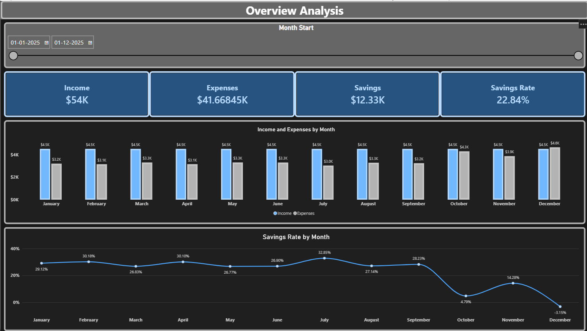
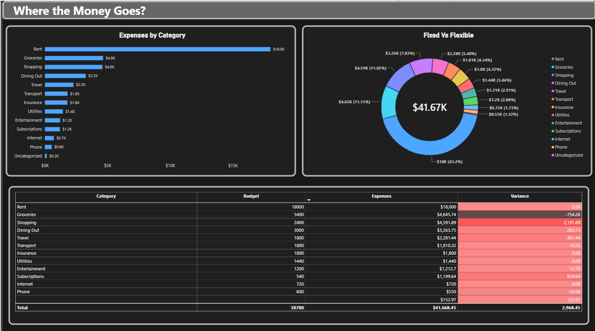

# Personal Finance Analysis (Excel + Power Query + Power BI)

**Question:** Where does the money go, is enough being saved, and what should change?

> **Data note:** All data is synthetic, generated in Excel for a fictional
> single professional (USD, Jan-Dec 2025). Findings show my method,
> not real behavior. Patterns were planted on purpose so I could test
> whether the analysis recovers them.

## Dashboard

## Workflow
1. Excel: lookup sheets (Categories, Fixed, Flex, Merchants) generate 546 transactions.
2. Planted patterns: October overspend, Nov/Dec holiday spike, 3 forgotten subscriptions.
3. Planted problems in a raw copy: 3 merchant spellings (Amazon), 5 duplicates,
   4 blank categories, 3 bad dates.
4. Power Query cleaning: 551 rows, then 548 (bad dates removed), then 543 (duplicates removed).
5. Power BI: 2 pages with DAX measures (Income, Expenses, Savings, Savings Rate, Budget, Variance).
6. A cleaning mistake I caught: my first bad-date row was a salary row. I traced it and moved the bad date to a small purchase.

## Key results (from the synthetic data)
- Savings rate: 22.84% vs about 28% planned.
- October 4.79% and December -3.15%: the overspend and holiday spike were recovered.
- Subscriptions: $1,199.64 vs a $540 budget (+$659.64) from the planted leak.
- Largest budget overruns: Shopping, Travel, Dining Out, Subscriptions.

## Recommendation (for the fictional user)
Cancel the 3 unused subscriptions (about $660 a year) and cap Shopping.

## Limits
- Synthetic data, so conclusions are not about real spending.
- A weekend-spending pattern was planned but not built, so it is not analyzed.
- 4 uncategorized transactions ($152.97) show as (Blank) in Power BI.
- The Budget measure assumes every category has data in all 12 months.
- Built in Excel 2019 (no dynamic arrays), so formulas use INDEX/MATCH/SUMIFS.

## Files
- `excel/finance_data.xlsx`: data build, raw copy, Power Query cleaning
- `powerbi/finance_analysis.pbix`: dashboard
- `insights/`: dashboard screenshots